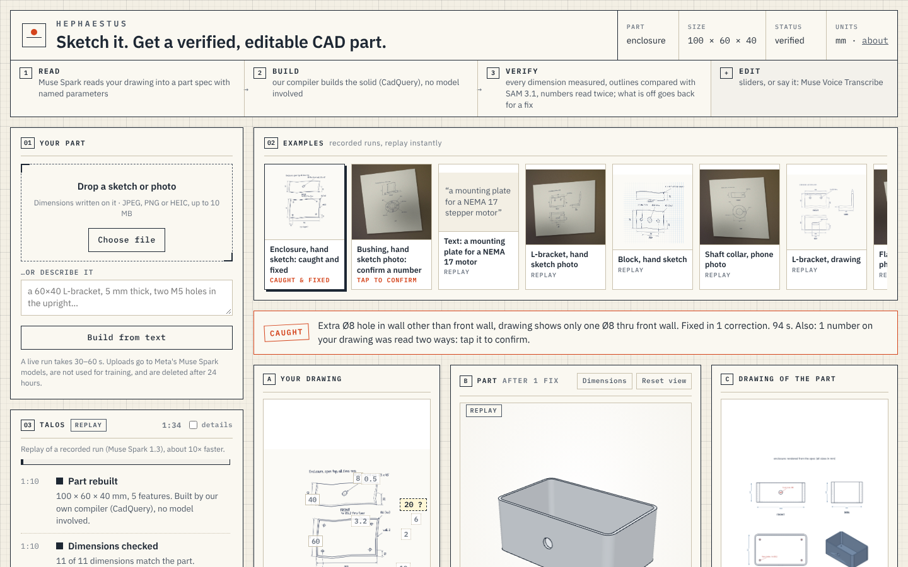

# Hephaestus

**Sketch it. Get a verified, editable CAD part.**
A dimensioned sketch, a phone photo of one, or a description in words becomes a parametric CAD part (STEP, STL,
sliders). Powered by **Talos**, an agent that builds the part, checks it against your drawing and corrects itself
until the geometry matches.

Built during the [Meta Global AI Developer Hackathon](https://dev.meta.ai/events/global-hackathon), Oct 26 – Nov 4, 2026, on Meta's Muse Spark, SAM 3.1 and Muse Voice Transcribe models.

## Web app

**Live: <https://hephaestus-talos.netlify.app>** (backend: Modal).

`web/` (static, Netlify) + `server/` (FastAPI on Modal). Upload a sketch or photo, take one with your phone, or
describe the part in words; watch Talos read, build, check and correct it live; drag the parameter sliders to
rebuild the part instantly; change it in words, typed or spoken ("make the holes M6", "remove the slot"); download
STEP, STL and the spec. Ten examples replay recorded runs instantly; the first starts on its own: a hand-sketched
enclosure where Talos catches a hole drilled through the wrong wall and fixes it. The four demo runs from the final
benchmark (live model, full event streams) are in [`web/replays`](web/replays/); one older example, the hand-sketched
block whose 40 is read as 60, was recorded with the cheaper development model and says so. Deployment and limits: [`server/README.md`](server/README.md).

UI check (Playwright, desktop and phone, mock backends): [`experiments/ui/check_ui.js`](experiments/ui/check_ui.js), 60/60.

## How it works

1. **Read.** Muse Spark turns the drawing into a structured part spec (features + named parameters, see
   [`docs/spec-v1.md`](docs/spec-v1.md)) and lists every dimension it read, as *callouts*.
2. **Compile.** A deterministic compiler builds the part with CadQuery: STEP, STL, metrics, silhouettes.
3. **Verify.** Callouts are measured on the compiled geometry. **SAM 3.1** segments each view of the drawing (after
   finding and straightening the sheet in a photo) and the outline is compared with the part's silhouette: a part
   that is mirrored, rotated or has other proportions is caught without asking a model's opinion. Only if both pass,
   a separate critic call compares the drawing with a rendered drawing sheet of the part.
4. **Correct.** Any compile error, callout mismatch, shape issue or critic issue goes back to the model, until
   everything passes. The critic cannot loop on its own: an issue only the critic sees gets one correction, and if
   that does not hold up, the measured part is kept and the critic's issue is shown as an unverified note.
5. **Edit.** After that, the part can be changed in words: typed, or spoken and transcribed by **Muse Voice
   Transcribe** (the transcript is shown for correction first). Muse Spark (low effort) turns the instruction into a
   small structured edit (parameter values, holes, slots, patterns, fillets, chamfers, pockets, or a clarifying
   question when the instruction is ambiguous or impossible); our code applies it, rebuilds and validates. The part
   is then marked *edited*: the drawing's dimensions you changed leave the check, the others still count.

Details: [`docs/talos.md`](docs/talos.md). Run it with `python -m hephaestus.talos drawing.png --out out/run1/`.

## Results (final, Nov 2026)

One run of the shipping product on every test input (Oct 31, 2026): live preset (`muse-spark-1.3`), every check
on (callouts, SAM 3.1 shape check, number re-read, 2-sample critic), 1 run each, 70 runs, **$4.49**. A part is
*perfect* when its compiled geometry matches the true part (bbox, volume IoU ≥ 0.98, every written dimension within
0.5 mm). Script and every event stream: [`experiments/final`](experiments/final/)
([summary](experiments/final/results/summary.md)). Earlier development rounds: [`docs/experiments.md`](docs/experiments.md).

**Drawings and sketches** (8 parts: plates, brackets, a revolved bushing, a shelled enclosure, a pocket plate, a
shaft collar):

| input | perfect read | after the loop | after one tap per flagged number | first part (median / p90) | verified (median / p90) | cost / run |
|---|---|---|---|---|---|---|
| printed drawing, clean | 7/8 | 7/8 | 7/8 | 29 s / 72 s | 44 s / 101 s | $0.08 |
| printed drawing, phone photo | 7/8 | 7/8 | 7/8 | 28 s / 33 s | 46 s / 75 s | $0.08 |
| printed drawing, rough pencil photo | 7/8 | 7/8 | 7/8 | 28 s / 43 s | 42 s / 93 s | $0.09 |
| hand sketch (not to scale), scan | 6/8 | **7/8** | 7/8 | 28 s / 41 s | 52 s / 94 s | $0.08 |
| hand sketch, phone photo | 6/8 | 6/8 | **7/8** | 25 s / 37 s | 42 s / 60 s | $0.08 |
| **all 40** | 33/40 | 34/40 | **35/40** | 27 s | 46 s | $0.08 |

- **The loop** fixed one sketch outright: the enclosure's cable hole was drilled through both walls; the second look
  (a separate Muse Spark call) saw it and one correction fixed it. On the rough L-bracket it caught the upright at
  the wrong side (SAM shape check) and moved it, but other misread dimensions remained.
- **The number re-read** flagged the one misread digit it could see: the bushing's handwritten flange 5, read as 3.
  One tap fixes the part. It cost $0.005 and 4 s per run (median), in parallel with the first compile.
- **Flags on correct numbers**: 36 "confirm?" chips over 40 runs (0.9 per run, at most 4), and 1 red chip (the
  hand block photo's 70, backed by the shape check's proportion note on a not-to-scale sketch). A chip only asks;
  nothing changes until you tap.

**Injected errors**: a correct spec with one deliberate mistake, checked against the real (clean) drawing:

| error | caught by | fixed |
|---|---|---|
| hole moved 5 mm · hole missing · wrong diameter · chamfer instead of fillet · slot turned 90° · plate X/Y swapped · hole pair at the wrong end | callouts | 7/7 |
| upright at the front instead of the back (L-bracket) · slope profile mirrored (angled bracket) | SAM 3.1 shape check | 2/2 |
| cable hole drilled through both walls | critic (second look) | **no**: its correction dropped a hole depth, did not compile, and the critic gets one try |
| *false alarms on the 8 correct parts* | | **0/8** |

**Text prompts**: 12/12 as expected ($0.04 per run, first part after 20 s). The interesting ones:
- "a mounting plate for a NEMA 17 stepper motor": no number given, the named standard supplies them (42.3 mm square,
  31 mm hole spacing, 22 mm pilot), each marked *assumed*.
- "a 50 mm cube with a 60 mm hole": not refused; it builds a 40 mm hole and flags the 60 as conflicting, so you pick.
- "a simple washer": no size at all, so it asks for one (Talos never guesses the scale).

**Honest limits**
- A misreading every check shares gets through: the angled bracket's 15 and 10 swap places (printed clean and phone
  photo), and the hand block's 46 read as 40 by both readings. The re-read catches illegible digits, not plausible
  wrong ones.
- About one "confirm?" flag per sketch on numbers that were right.
- Synthetic test data: the drawings, photos and hand sketches are ours (rendered, printed, photographed, drawn in
  handwriting fonts); no real users' sketches yet.
- Photos of real objects (no drawing) are not shipped; the code is in `object_photo.py`, hidden until tested on real
  photos.

## Third-party code

- **[meta-sam-parser](https://pypi.org/project/meta-sam-parser/) 0.1.0** (pip dependency, not vendored) decodes SAM
  3.1's mask payloads in `hephaestus/sam.py`. Published by Meta Platforms, Inc. (source:
  <https://github.com/meta-models/meta-sam>) under the **SAM License** (Nov 19, 2025), which grants a
  non-exclusive, worldwide, royalty-free licence to use, reproduce, distribute and modify the SAM Materials; anyone
  redistributing them must include the licence. This repo only depends on the package; the licence text ships in
  the package's `licenses/` folder.
- CadQuery / OpenCascade (Apache 2.0 / LGPL), FastAPI, three.js, NumPy, SciPy, OpenCV, Pillow: standard open-source
  dependencies installed from their package registries.
